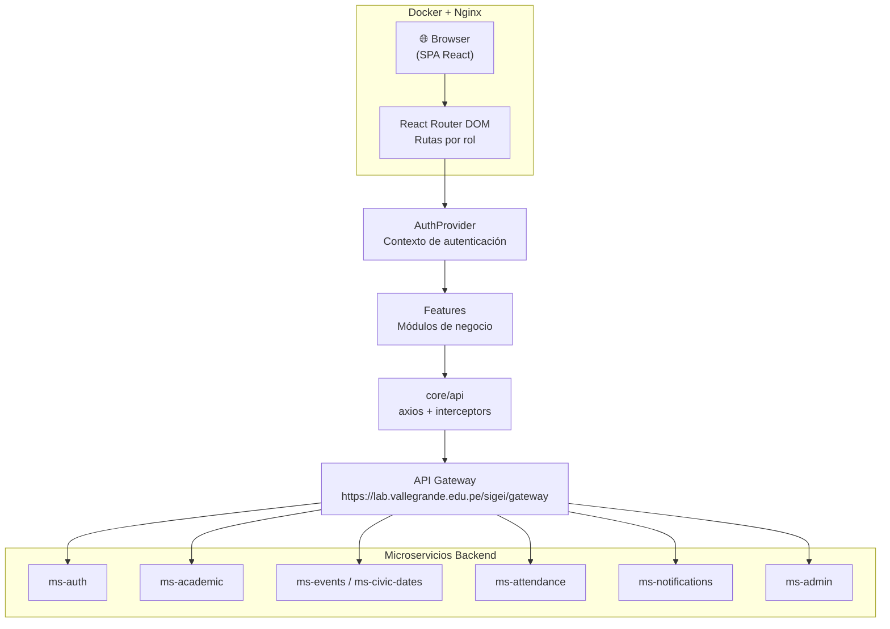

# 🎓 SIGEI — Sistema Integrado de Gestión Educativa (Frontend Web)

Frontend web SPA del sistema institucional **SIGEI** (Valle Grande), que centraliza la gestión de alumnos, docentes, asistencia, calificaciones, matrículas, eventos, fechas cívicas, psicología y comunicación por WhatsApp. Desplegado en producción sobre Nginx + Docker con CI/CD automatizado via GitLab.

---

## 🏷️ Badges


---

## ✨ Funcionalidades Principales

| Módulo | Descripción |
|--------|-------------|
| 🔐 **Autenticación** | Login con JWT, refresh token, cambio de contraseña, roles diferenciados |
| 👥 **Usuarios** | CRUD de usuarios por rol, foto de perfil via Cloudinary |
| 🎓 **Alumnos** | Gestión de estudiantes, apoderados, foto y QR individual |
| 📋 **Matrículas** | Registro de matrículas por período académico |
| ✅ **Asistencia** | Control de asistencia con QR scanner (individual y masivo), justificaciones |
| 📚 **Académico** | Cursos, competencias, capacidades, niveles de desempeño |
| 📝 **Calificaciones** | Evaluaciones por competencia, finalización y cancelación |
| 🧠 **Psicología** | Evaluaciones psicológicas y soporte a necesidades especiales |
| 📐 **Disciplina** | Registro y seguimiento de incidentes disciplinarios |
| 📅 **Eventos y Fechas Cívicas** | Calendarios académicos, eventos recurrentes, fechas cívicas peruanas, generación de reportes PDF |
| 💬 **Notificaciones WhatsApp** | Envío masivo de mensajes, conexión por QR, estado de sesión |
| 🛠️ **Admin** | Backups por base de datos, restauración, reset del sistema, roles, templates |
| 🏫 **Instituciones** | CRUD de instituciones educativas, aulas y salones |
| 🏠 **Dashboards por Rol** | Vistas personalizadas: Admin, Director, Docente, Auxiliar, Psicólogo, Secretaría, Familia |

---

## 🛠️ Stack Tecnológico

| Categoría | Tecnología | Versión |
|-----------|-----------|---------|
| Framework UI | React | 19.2 |
| Build Tool | Vite + SWC | 7.3 |
| Estilos | TailwindCSS | 4.2 |
| Routing | React Router DOM | 7.13 |
| HTTP Client | Axios | 1.13 |
| Animaciones | Framer Motion + GSAP | 12.x / 3.14 |
| PDF Export | jsPDF + html2canvas | 4.2 / 1.4 |
| QR | qrcode.react + jsqr | 4.2 / 1.4 |
| Alertas | SweetAlert2 + react-hot-toast | 11.x |
| Iconos | lucide-react | 0.575 |
| Despliegue | Nginx (Alpine) + Docker | 1.27 |
| CI/CD | GitLab CI | — |
| Testing | Selenium WebDriver (Node) | 4.45 |
| Auth | JWT (Bearer Token) | — |

---

## 🏗️ Arquitectura



---

## 📁 Estructura del Proyecto

```
sigei-frontend/
├── public/                         # Assets estáticos
├── src/
│   ├── App.jsx                     # Raíz: BrowserRouter + AuthProvider
│   ├── main.jsx                    # Punto de entrada
│   ├── core/
│   │   ├── api/
│   │   │   ├── apiClient.js        # Instancia Axios + base URL dinámica
│   │   │   ├── endpoints.js        # Mapa completo de endpoints
│   │   │   └── interceptors.js     # Token injection + refresh automático
│   │   ├── auth/
│   │   │   ├── AuthContext.js      # Contexto global de auth
│   │   │   ├── AuthProvider.jsx    # Proveedor: login, logout, refresh
│   │   │   ├── ProtectedRoute.jsx  # HOC guarda de ruta
│   │   │   └── RoleGuard.jsx       # HOC guarda por rol
│   │   ├── hooks/                  # useDebounce, useLocalStorage, usePagination
│   │   ├── store/                  # useAppStore, useNotificationStore (Zustand-like)
│   │   └── utils/                  # constants, formatters, validators, token, storage
│   ├── features/
│   │   ├── auth/                   # LoginPage
│   │   ├── dashboard/              # Dashboards por rol (7 variantes)
│   │   ├── events/                 # ⭐ Eventos, Calendarios, Fechas Recurrentes
│   │   ├── students/               # CRUD alumnos + apoderados + QR
│   │   ├── teachers/               # Asignaciones docentes
│   │   ├── attendance/             # Asistencia + QR scanner masivo
│   │   ├── academic/               # Cursos, competencias, desempeño
│   │   ├── grades/                 # Evaluaciones y calificaciones
│   │   ├── enrollments/            # Matrículas y períodos académicos
│   │   ├── discipline/             # Incidentes disciplinarios
│   │   ├── psychology/             # Evaluaciones psicológicas
│   │   ├── institutions/           # Instituciones y aulas
│   │   ├── users/                  # Gestión de usuarios
│   │   ├── profile/                # Perfil de usuario
│   │   └── admin/                  # Configuración, roles, templates, backups
│   ├── router/                     # AppRouter + rutas protegidas por rol
│   └── shared/
│       ├── components/
│       │   ├── ui/                 # Button, Modal, Table, Badge, Input, Select, ...
│       │   ├── form/               # DatePicker, FileUpload, SearchInput
│       │   ├── layout/             # Header, Sidebar, Footer, MainLayout
│       │   └── feedback/           # ErrorBoundary, LoadingScreen, EmptyState, Confirm
│       └── hooks/                  # useRealTimeValidation
├── test/
│   └── civicDates/                 # Tests Selenium: sin auth, login exitoso, SQL injection
├── Dockerfile                      # Multi-stage: node:20-alpine → nginx:1.27-alpine
├── nginx.conf                      # Configuración Nginx SPA (try_files)
├── .gitlab-ci.yml                  # Pipeline: build Docker image → deploy webhook
├── vite.config.js                  # Build + alias @ + proxy /api → gateway
└── .env.example                    # Variables de entorno requeridas
```

---

## 🔐 Seguridad

- **JWT Bearer Token** inyectado automáticamente en cada request via interceptor Axios.
- **Refresh automático** de token antes de expiración (`interceptors.js`).
- **ProtectedRoute** y **RoleGuard** bloquean acceso a rutas no autorizadas por rol.
- **`window.APP_CONFIG`** inyectado en runtime por Nginx (el `VITE_API_URL` nunca queda hardcodeado en el bundle JS).
- **`.env` excluido del repositorio** mediante `.gitignore`. Usar `.env.example` como plantilla.
- **Tokens almacenados** en memoria / localStorage con utilidades centralizadas (`token.js`, `storage.js`).
- **Tests de seguridad**: `tc003-sql-injection.js` valida que el backend rechaza inputs maliciosos.

---

## 🌐 API — Endpoints Consumidos

> El cliente HTTP apunta a: `https://lab.vallegrande.edu.pe/sigei/gateway`

| Módulo | Base Endpoint |
|--------|---------------|
| Auth | `POST /api/auth/login`, `POST /api/auth/refresh`, `POST /api/auth/logout` |
| Usuarios | `GET/POST/PUT /api/users`, `GET /api/users/me` |
| Alumnos | `GET/POST/PUT /api/students`, `GET /api/students/classroom/:id` |
| Apoderados | `GET/POST /api/guardians` |
| Matrículas | `GET/POST/PUT /api/v1/enrollments` |
| Períodos Académicos | `GET/POST /api/v1/academic-periods` |
| Asistencia | `GET/POST /api/v1/attendance` |
| Cursos | `GET/POST /api/v1/courses` |
| Calificaciones | `GET/POST /api/v1/evaluations` |
| Psicología | `GET/POST /api/psychological-evaluations` |
| Disciplina | `GET/POST /api/v1/incidents` |
| Instituciones | `GET/POST/PUT /api/institutions` |
| Aulas | `GET/POST /api/classrooms` |
| **Eventos** | `GET/POST/PUT /api/v1/events` |
| **Calendarios** | `GET/POST/PUT /api/v1/calendars`, `GET /api/v1/calendars/:id/events` |
| **Eventos Recurrentes** | `GET/POST /api/v1/recurring-events` |
| **Fechas Cívicas** | `GET /api/civic-dates/year/:year`, `GET /api/civic-dates/year/:y/month/:m` |
| Notificaciones WhatsApp | `POST /api/v1/notifications/send`, `GET /api/v1/notifications/whatsapp/qr` |
| Admin / Backups | `GET /api/admin/backups`, `POST /api/admin/backups/create` |

---

## ⚙️ Cómo Ejecutar Localmente

### Prerrequisitos
- Node.js ≥ 20
- Acceso a la red de Valle Grande (o VPN) para conectar al gateway

### 1. Clonar e instalar
```bash
git clone <url-del-repositorio>
cd sigei-frontend
npm install
```

### 2. Configurar variables de entorno
```bash
cp .env.example .env
```

Editar `.env`:
```env
VITE_API_URL=https://lab.vallegrande.edu.pe/sigei/gateway
```

> En desarrollo, Vite redirige `/api` al gateway via proxy (`vite.config.js`).

### 3. Ejecutar
```bash
npm run dev
# → http://localhost:5173
```

### 4. Build para producción
```bash
npm run build
# Output en /dist — listo para Nginx
```

### 5. Con Docker
```bash
docker build --build-arg VITE_API_URL=https://lab.vallegrande.edu.pe/sigei/gateway -t sigei-frontend .
docker run -p 80:80 sigei-frontend
```

---

## 🧪 Pruebas

Tests automatizados con **Selenium WebDriver** (Node.js), enfocados en el módulo de Fechas Cívicas:

```bash
# TC001 - Acceso sin autenticación (debe redirigir a login)
npm run test:tc001

# TC002 - Login exitoso y acceso al módulo
npm run test:tc002

# TC003 - Validación contra SQL Injection
npm run test:tc003
```

> Tests de módulo académico (`academic-yennifer`, `security-yennifer`) fueron desarrollados por otro integrante del equipo.

---

## 🚀 CI/CD — GitLab CI

Pipeline definido en `.gitlab-ci.yml`. Se activa al hacer push a `main` o crear un tag:

```
push → main
   │
   ├─ [docker] Build imagen Docker → Push a Docker Hub
   │           oscarochoa01/sigei-web:latest + :SHA
   │
   └─ [deploy] Webhook POST → servidor VPS (auto-pull + restart)
```

| Variable CI/CD | Descripción |
|----------------|-------------|
| `DOCKER_TOKEN` | Token de Docker Hub (configurado en GitLab Secrets) |

---

## 👨‍💻 Rol y Aportes — Lorenzo Campos

Proyecto en equipo (Valle Grande — SIGEI). Responsable del módulo:

### ⭐ Módulo: Eventos y Fechas Cívicas
- `src/features/events/pages/EventsPage.jsx` — Página principal de gestión de calendarios y eventos (CRUD completo, múltiples vistas: lista, calendario, tarjetas por año)
- `src/features/events/pages/RecurringEventsPage.jsx` — Administración de eventos recurrentes
- `src/features/events/components/CalendarView.jsx` — Componente de vista tipo calendario
- `src/features/events/components/YearCardsView.jsx` — Vista por cards de años académicos
- `src/features/events/services/eventService.js` — Servicio HTTP para eventos
- `src/features/events/services/calendarService.js` — Servicio HTTP para calendarios
- `src/features/events/services/recurringEventService.js` — Servicio HTTP para eventos recurrentes
- `src/features/events/services/eventReportService.js` — Generación de reportes PDF de eventos
- `src/features/events/models/eventModel.js` — Modelos, tipos, estados y generación de fechas cívicas peruanas
- `src/features/events/models/calendarModel.js` — Modelo de calendarios académicos
- `test/civicDates/` — 3 casos de prueba Selenium (acceso sin auth, login exitoso, SQL injection)

### 🤝 Aportes Conjuntos (con el equipo)
- Arquitectura Feature-Based (`src/features/`, `src/core/`, `src/shared/`)
- Configuración del `apiClient.js` con base URL dinámica via `window.APP_CONFIG`
- Configuración Nginx + Dockerfile multi-stage para despliegue en producción
- Definición de endpoints en `src/core/api/endpoints.js`

---

## 🗺️ Roadmap

- [ ] Internacionalización (i18n) español / inglés
- [ ] Modo oscuro global
- [ ] PWA — soporte offline para asistencia con QR
- [ ] Integración con calendario Google para exportar eventos cívicos
- [ ] Dashboard con gráficas interactivas (Chart.js / Recharts)
- [ ] Notificaciones push en tiempo real (WebSocket)

---

## 📬 Contacto

**Lorenzo Campos**  
📧 [lorenzo.campos.p@vallegrande.edu.pe](mailto:lorenzo.campos.p@vallegrande.edu.pe)  
💼 [linkedin.com/in/lorenzo-campos](https://www.linkedin.com/in/lorenzo-campos)
